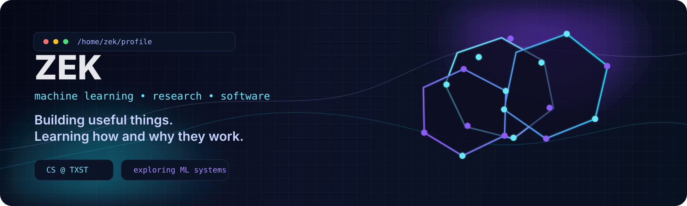

<div align="center">
  

  <br/>

  [](https://git.io/typing-svg)

  <br/>

  <a href="https://github.com/nikolas-AI"></a>
  <a href="https://www.linkedin.com/in/prashant-subedi/"></a>
  <a href="https://twitter.com/zek_p7s5"></a>
  <a href="https://nikolas-ai.github.io/Portfolio/"></a>
</div>

---

## about me

I’m **Zek** 

Right now I’m most interested in the intersection of:
- **machine learning**
- **mathematics**
- **research-driven software**
- **clean product design**


---

## status

```bash
zek@github:~$ whoami
name: Zek
role: Computer Science student
location: Texas, USA
focus: machine learning, frontend, product-minded software
currently learning: how models train, generalize, and fail
```

---

## featured projects

<table>
<tr>
<td width="50%" valign="top">

### [Zorads / AImigos](https://github.com/nikolas-AI/Zorads-HckTx)
Group chat with AI companions. A HackTX project built around bringing people and AI into one conversation.

</td>
<td width="50%" valign="top">

### [CIMT](https://github.com/nikolas-AI/CIMT)
A web tool for estimating a clinic's community impact using volunteer hours and services delivered.

</td>
</tr>
<tr>
<td width="50%" valign="top">

### [Normalized Gradient Descent](https://github.com/nikolas-AI/Normalized-GD)
Experiments with NGD and stochastic NGD for two-layer neural networks, including research-paper figure reproduction.

</td>
<td width="50%" valign="top">

### [UI4ANOT](https://github.com/nikolas-AI/UI4ANOT)
A desktop annotation assistant for perceptual quality assessment of distorted 3D point clouds.

</td>
</tr>
<tr>
<td width="50%" valign="top">

### [Galactic Mayhem](https://github.com/nikolas-AI/Galactic_Mayhem)
A Python arcade game — because sometimes building something fun is the entire point.

</td>
<td width="50%" valign="top">

### [Forrest Gump](https://github.com/nikolas-AI/Forrest_Gump)
A runner game built with Pygame.

</td>
</tr>
</table>

---

## stack

<div align="center">
  
</div>

<div align="center">

| area | tools |
|---|---|
| languages | Python, JavaScript, C, C++ |
| web | HTML, CSS, React |
| tools | Git, GitHub, VS Code |
| design | Figma, Canva |

</div>

---

## github pulse

<div align="center">
  
  
</div>

<div align="center">
  
</div>

<div align="center">
  <picture>
    <source media="(prefers-color-scheme: dark)" srcset="https://raw.githubusercontent.com/nikolas-AI/nikolas-AI/output/github-contribution-grid-snake-dark.svg" />
    <source media="(prefers-color-scheme: light)" srcset="https://raw.githubusercontent.com/nikolas-AI/nikolas-AI/output/github-contribution-grid-snake.svg" />
    
  </picture>
</div>

---


<div align="center">

### let’s connect

<a href="https://www.linkedin.com/in/prashant-subedi/">LinkedIn</a> •
<a href="https://twitter.com/zek_p7s5">X</a> •
<a href="https://nikolas-ai.github.io/Portfolio/">Portfolio</a>

<br/><br/>

<sub>Thanks for stopping by.</sub>
</div>
